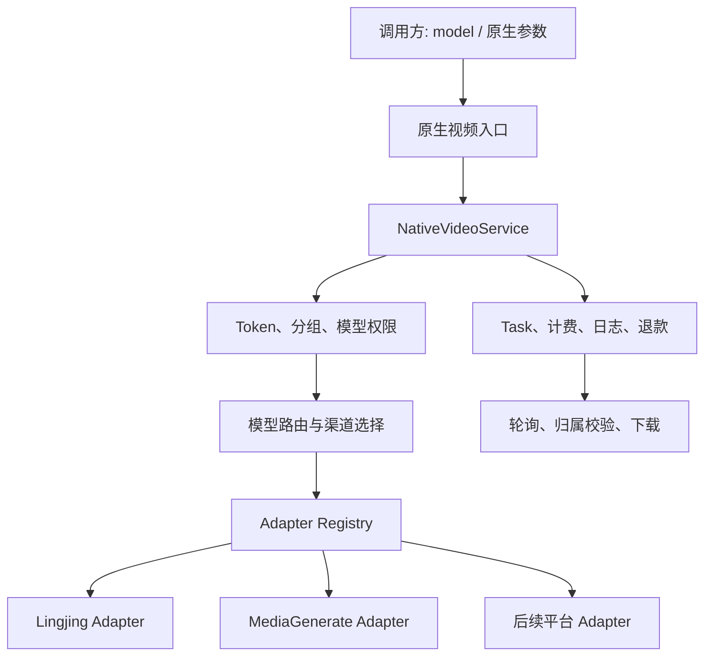

# 多平台原生视频接入与路由架构

> 状态：已实施。首个适配器为 `lingjing`；新增平台只需实现注册的原生视频适配器，无需复制任务、计费或权限逻辑。

## 目标

New API 需要同时接入多个已经获得授权的视频生成上游，并允许管理员在不改动调用方的前提下切换默认平台、按模型分流，或在兼容的平台之间进行渠道容灾。

本方案的原则是：**统一任务与调度内核，保留平台原生协议。** 不将原生视频请求转换为 OpenAI、Sora、Doubao 或图片生成请求格式，也不为每个平台复制一套鉴权、计费、任务、查询和下载逻辑。

## 核心决策

| 概念 | 标识示例 | 控制方 | 职责 |
| --- | --- | --- | --- |
| 逻辑模型 | `video-default`、`video-standard-15s` | 调用方和管理员 | 用户可见的产品能力、价格档位和路由意图 |
| 渠道 | 渠道 ID | 管理员 | 一个上游账号、Base URL、Key、分组、优先级和权重 |
| 平台/适配器 | `lingjing`、`media_generate` | 系统 | 上游协议、请求校验、状态解析和下载行为 |
| 上游模型 | `lingjing-video-v1` | 渠道配置 | 该渠道实际发送给上游的模型名 |

1. **调用方以 `model` 选择产品，不直接选择 Channel ID。** Channel 是调度实现细节；向普通 Token 暴露它会绕过模型权限、价格和容灾策略。
2. **使用稳定字符串保存平台身份。** `task.platform` 必须保存 `lingjing` 这类字符串，不能保存 `59` 这类渠道类型数字。
3. **所有原生视频渠道共用一个 `NativeVideo` 渠道类型。** 具体协议通过持久化的 `adapter_key` 区分，而不是为每个新供应商增加一个私有数字渠道类型。
4. **任务创建后固定平台和渠道。** 查询、下载、轮询、结算和退款永远使用创建时记录的 `platform`、`channel_id`、上游任务 ID 和计费快照。
5. **平台原生接口只是薄门面。** `/v1/lingjing/*`、未来的 `/v1/media-generate/*` 都进入同一个原生视频服务层；Controller 不得直接依赖某个具体适配器。



## 模型驱动的路由与默认值

推荐将模型作为唯一的普通用户侧切换标识。管理员通过渠道的模型列表和模型映射决定一个逻辑模型可使用哪些平台。

### 模型解析优先级

```text
显式且非默认的 model
  > 用户所属分组的默认视频模型
  > 全局默认视频模型
  > 拒绝请求：没有可用默认模型
```

TokenAuth 先识别调用方及其分组；当 `model` 缺失或值为 `video-default` 时，服务端再将其解析为实际逻辑模型，并对解析结果执行既有的模型可用性校验。默认值应支持全局配置和分组覆盖；它不是某一个固定 Channel ID。

例如：

```text
video-default
  └─ video-standard-15s
       ├─ Lingjing 渠道 A，优先级 10
       ├─ MediaGenerate 渠道 B，优先级 5，权重 80
       └─ MediaGenerate 渠道 C，优先级 5，权重 20

lingjing-video-15s
  └─ 仅 Lingjing 渠道
```

这样管理员可以将 `video-default` 从 Lingjing 切换到 MediaGenerate，或调整候选渠道的优先级和权重，而无需让调用方修改请求。

### 候选渠道筛选

创建任务前，服务端按照以下顺序筛选并选择渠道：

1. 渠道已启用，用户分组可用，并包含解析后的逻辑模型；
2. 对应 `adapter_key` 支持本次请求的能力，例如时长、比例、参考图和音频；
3. 渠道存在可用 Key、模型映射和有效价格配置；
4. 使用 New API 现有的优先级和权重规则在候选渠道中选择；
5. 由选中渠道将逻辑模型映射为实际的上游模型，再发送原生请求。

同一个逻辑模型仅应覆盖语义和收费都兼容的平台。若请求包含某平台特有字段，例如仅 Lingjing 支持的 `reference_audios`，它必须被路由到平台绑定模型（例如 `lingjing-video-15s`），而不能静默降级到不支持该字段的平台。

上传得到的上游临时文件 ID 同样带有平台归属。第一期不应把某平台的上传 ID 当作跨平台通用资产；携带此类 ID 的创建请求必须固定到相同平台，除非后续建立 New API 自有的统一资产存储与转换层。

### 失败切换边界

仅在上游明确尚未接受创建请求时，才可以尝试下一个兼容渠道。网络超时等无法确认上游是否已受理的情形不得盲目跨平台重试；应依赖上游幂等键，或标记为待核对，以避免重复生成和重复扣费。

一旦获得上游任务 ID，任务即绑定到该平台和渠道。后续状态查询、下载、轮询、失败退款均不能重新按当前默认模型或渠道权重选择平台。

## 对外接口策略

### 1. 平台原生接口：保留并兼容

每个平台可保留自己的命名空间，用于完整保留其 multipart 和 JSON 协议，例如：

```text
POST /v1/lingjing/uploads
POST /v1/lingjing/videos
GET  /v1/lingjing/videos/{task_id}
GET  /v1/lingjing/videos/{task_id}/download

POST /v1/media-generate/uploads
POST /v1/media-generate/videos
GET  /v1/media-generate/videos/{task_id}
GET  /v1/media-generate/videos/{task_id}/download
```

这些路由只负责将平台键传给通用服务。上传必须原样转发 multipart；创建必须原样保留平台支持的 JSON 字段；下载必须流式转发视频内容和必要响应头，并正确透传 302 重定向。

### 2. 模型驱动的统一入口：只承载可移植能力

如业务方需要在调用侧无感切换平台，可增加不与内置 Sora 接口冲突的统一入口，例如：

```text
POST /v1/native-video/generations
GET  /v1/native-video/tasks/{task_id}
GET  /v1/native-video/tasks/{task_id}/download
```

该入口只承诺各候选平台共同支持的字段，如 `model`、`prompt`、受控的 `duration`、`ratio` 和明确标准化的参考资源。它不是把全部供应商伪装成同一种协议的转换器。

需要厂商特有字段、上传 ID 或行为时，调用方应使用平台原生接口和平台绑定模型。两类入口必须调用同一个 `NativeVideoService`，不得形成两套 Task、计费或权限实现。

## 内部职责边界

### `NativeVideoService`

通用服务负责：

- TokenAuth、分组权限、模型可用性和渠道分发；
- 默认模型解析、能力筛选、渠道选择和模型映射；
- 创建前预扣费、Task 创建、日志写入、轮询、失败结算和退款；
- 按用户归属查找公共任务 ID；
- 统一处理响应头白名单、流式转发和 302 透传；
- 确保上游 API Key 永不出现在客户端响应中。

### `NativeVideoAdapter`

适配器仅负责本平台协议差异，建议至少提供以下能力：

```go
type NativeVideoAdapter interface {
    Key() string
    Capabilities() NativeVideoCapabilities
    ValidateCreate(rawRequest []byte) error
    EstimateBilling(rawRequest []byte) (map[string]float64, error)
    BuildUploadRequest(...) (*http.Request, error)
    BuildCreateRequest(...) (*http.Request, error)
    BuildFetchRequest(...) (*http.Request, error)
    BuildDownloadRequest(...) (*http.Request, error)
    ParseCreateResponse(...) (upstreamTaskID string, result any, err error)
    ParseTaskStatus(...) (NativeVideoTaskStatus, error)
}
```

接口的具体参数可以随着现有 `TaskAdaptor` 和 Relay DTO 调整，但边界应保持不变：适配器不负责用户鉴权、数据库 Task 写入、渠道分发、余额扣除或退款；Controller/Service 也不应 import 具体平台包。

对于仅支持创建和轮询的平台，可将上传和下载定义为可选能力，并由服务端返回明确的“不支持”错误，而不是为每个平台添加专用 Controller 分支。

## 数据与计费约束

渠道需要持久化以下稳定配置：

```text
type             = NativeVideo
adapter_key      = lingjing | media_generate | ...
base_url         = 上游域名
key              = 上游凭据
models           = 对外逻辑模型列表
model_mapping    = 逻辑模型 -> 上游模型
group/priority/weight/proxy
```

Task 至少需要冻结：

```text
public_task_id
user_id / token_id
channel_id
platform（稳定 adapter_key）
public_model / upstream_model
upstream_task_id
selected_key 或安全的 Key 引用
计费上下文、状态、创建时间
```

计费由选中的适配器在任务创建前计算。例如视频时长价格应将 `seconds` 作为倍率：

```text
实际扣费 = 每秒基础价格 × seconds × 用户分组倍率 × 其他有效倍率
```

上传、查询和下载不收取生成费用。失败、取消或超时任务必须沿用 Task 的一次性结算/退款状态，避免因重复轮询或重复下载造成重复退款或重复扣费。

若一个逻辑模型会在多个成本不同的平台间分流，管理员必须选择其一：为该逻辑模型配置稳定的用户价格并确保所有候选渠道满足成本约束，或拆分为不同的逻辑模型和价格档位。不得在用户提交后因随机选中渠道而改变其可预期价格。

## 迁移当前 Lingjing 实现

当前 Lingjing 实现应作为第一个 `NativeVideoAdapter`：

1. 将新写入 Task 的平台标识改为 `lingjing`，不再写入渠道类型数字 `59`；
2. 将 Lingjing 渠道标记为 `adapter_key = lingjing`；
3. 保留 `/v1/lingjing/*` 路由，但改为调用通用服务；
4. 在适配器注册表中以 `lingjing` 解析 Lingjing 适配器；
5. 对已部署任务提供旧值 `59` 到 `lingjing` 的兼容读取，并在确认渠道标识后迁移历史数据。

历史迁移必须以 `adapter_key` 或可验证的 Lingjing 渠道记录为条件，不能无条件将所有 `platform = "59"` 的任务转换。数据库迁移应使用 GORM 并同时兼容 SQLite、MySQL 和 PostgreSQL。

完成迁移后，私有分支只需要维护一个 `NativeVideo` 渠道类型数字；即使未来官方渠道类型发生数字冲突，影响范围也被限制在渠道配置迁移，不会破坏 Task 的平台解析。

## 实施顺序与验收

1. 引入稳定 `adapter_key`、`Task.Platform` 字符串值和适配器注册表，并保留旧 Lingjing 任务的兼容读取；
2. 从 Lingjing 专用 Controller 中抽取 `NativeVideoService`，统一上传、创建、查询和下载的鉴权、Task 归属和响应转发；
3. 让 Lingjing 适配器实现完整能力接口，并将平台路由降为薄门面；
4. 增加默认视频模型配置、能力筛选和模型驱动渠道选择；
5. 接入第二个平台，验证不新增专用 Task/Controller/计费/下载逻辑；
6. 为每个适配器执行共享的契约测试：鉴权、模型权限、原生请求转发、Key 隐藏、计费倍率、非法参数、任务归属、状态映射、流式下载、302 和一次性退款。

完成后，新增一个视频平台的主要工作应限定为：实现 Adapter、声明能力、配置渠道和模型映射、通过共享契约测试；不应再复制路由、Controller、Task 映射或结算逻辑。
